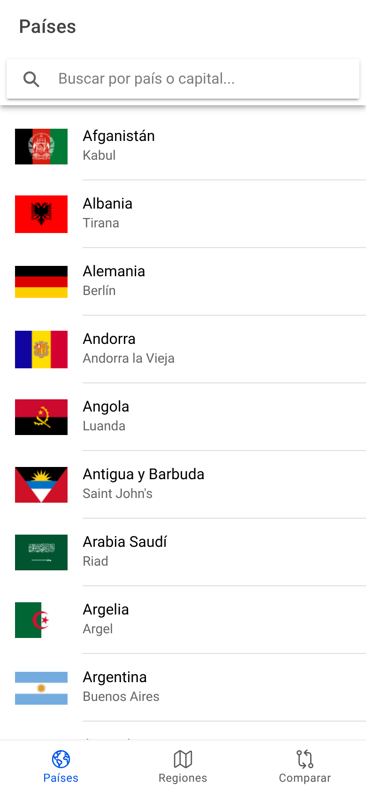
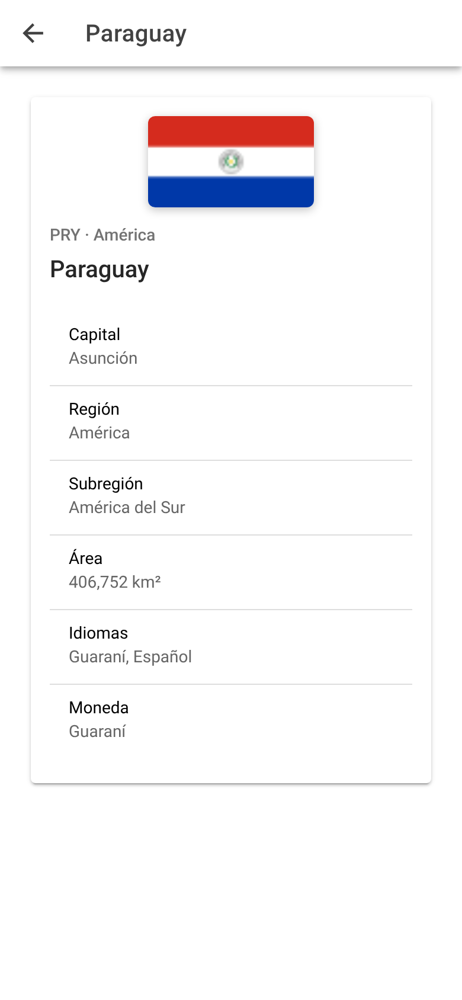
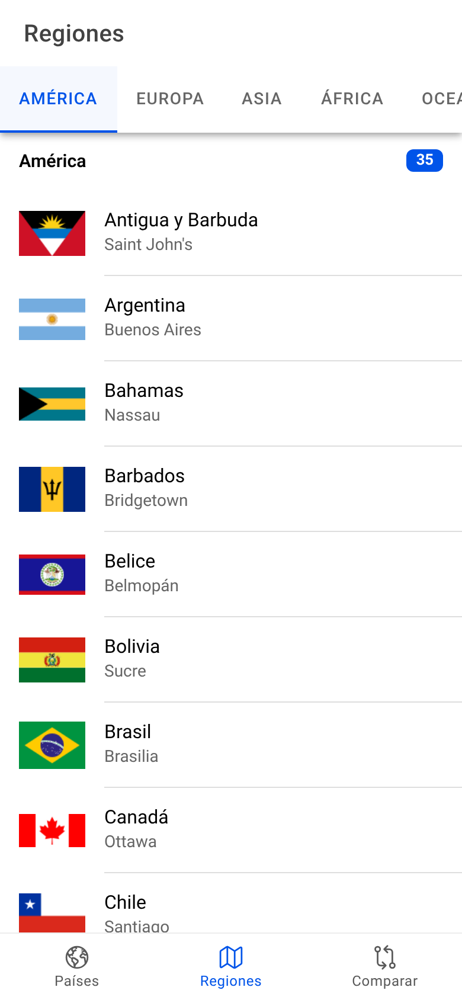
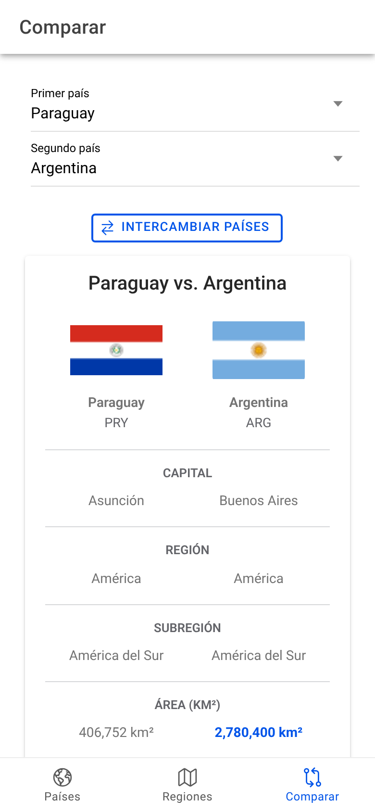

# Explorador de Países

Aplicación móvil híbrida desarrollada con **Ionic 9** y **Angular 21** para explorar información geográfica y cultural de 194 países de los cinco continentes, con funcionamiento 100 % offline.

* **Estudiante:** Tobias Ramirez
* **Asignatura:** Programación VI — Ingeniería Informática (Universidad del Norte)
* **Repositorio:** https://github.com/Tobydou21/TP_Programacion6

---

## Funcionalidades principales

1. **Países (`/tabs/paises`):**
   * Listado ordenado alfabéticamente de 194 países con su bandera, nombre y capital.
   * Buscador en tiempo real por nombre de país o capital, insensible a mayúsculas y tildes.
   * Indicador de carga (`ion-spinner`) y manejo de error con botón **Reintentar**.
2. **Detalle del país (`/detalle-pais/:codigo`):**
   * Ficha individual con bandera completa, código ISO, capital, región, subregión, área formateada en km², idiomas oficiales y moneda.
   * Indicador de carga, manejo de error con botón **Reintentar** y navegación de regreso mediante `ion-back-button`.
3. **Regiones (`/tabs/regiones`):**
   * Selector horizontal (`ion-segment`) por continente: **América (35)**, **Europa (45)**, **Asia (46)**, **África (54)** y **Oceanía (14)**.
   * Contador dinámico de países por región y acceso directo al detalle de cada país.
4. **Comparar (`/tabs/comparar`):**
   * Selección de dos países mediante `ion-select` para comparar lado a lado bandera, capital, región, subregión, superficie en km², idiomas y moneda.
   * Botón para intercambiar los países seleccionados.
   * Validación que avisa cuando se selecciona el mismo país en ambos campos.

---

## Fuente de datos

Los datos se generaron a partir del repositorio abierto **[mledoze/countries](https://github.com/mledoze/countries)**. Los datos y las banderas se guardan dentro del proyecto, así que la app no consulta servicios externos para cargarlos.

* **Datos estructurados:** `src/assets/data/paises.json` (194 países de América, Europa, Asia, África y Oceanía).
* **Banderas:** `src/assets/banderas/*.png` (194 imágenes descargadas de [flagcdn.com](https://flagcdn.com)).

---

## Tecnologías y arquitectura

* **Ionic Framework 9** (`@ionic/angular/lazy`)
* **Angular 21** con arquitectura modular tradicional (`NgModules`, `standalone: false`) y `Zone.js`
* **TypeScript 5.9** con tipado estricto (`interface Pais` en `src/app/models/pais.model.ts`)
* **RxJS / HttpClient** centralizado en `PaisesService` (`src/app/services/paises.service.ts`)

---

## Componentes principales

| Componente | Ubicación | Descripción |
|---|---|---|
| `PaisesPage` | `src/app/pages/paises/` | Listado con buscador y banderas |
| `DetallePaisPage` | `src/app/pages/detalle-pais/` | Ficha completa del país con carga y error |
| `RegionesPage` | `src/app/pages/regiones/` | Filtrado por continente con `ion-segment` |
| `CompararPage` | `src/app/pages/comparar/` | Comparación lado a lado de dos países |
| `TabsPage` | `src/app/tabs/` | Navegación inferior con 3 pestañas |
| `PaisesService` | `src/app/services/` | Servicio centralizado de datos (HttpClient + JSON local) |
| `Pais` (interfaz) | `src/app/models/` | Modelo tipado de país |

## Componentes de Ionic usados
`ion-searchbar`, `ion-list`, `ion-item`, `ion-thumbnail`, `ion-label`, `ion-segment`,
`ion-segment-button`, `ion-select`, `ion-select-option`, `ion-card`, `ion-grid`,
`ion-spinner`, `ion-button`, `ion-back-button`, `ion-icon`

---

## Instalación y ejecución

1. Clonar el repositorio e ingresar a la carpeta del proyecto:
   ```bash
   git clone https://github.com/Tobydou21/TP_Programacion6.git
   cd TP_Programacion6
   ```

2. Instalar las dependencias (requiere Node.js 20.19+, 22.12+ o 24, e Ionic CLI):
   ```bash
   npm install
   ```

3. Iniciar el servidor de desarrollo:
   ```bash
   ionic serve
   ```

---

## Capturas de pantalla

| Países | Detalle |
|:---:|:---:|
|  |  |

| Regiones | Comparar |
|:---:|:---:|
|  |  |
